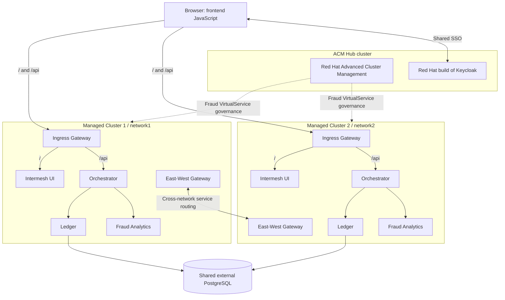

# Intermesh Bank

Intermesh Bank is a banking microservices demonstration for OpenShift Service
Mesh 3. It combines a browser-based UI, a Quarkus Orchestrator, a Go Ledger,
Fraud Analytics and a Rust Proxy-Wasm plugin to demonstrate service routing,
session affinity and workload unavailability across multiple networks.

## Architecture

The reference deployment uses three OpenShift clusters: an ACM Hub and two
managed clusters in a multi-primary, multi-network mesh. Both managed clusters
run UI, Orchestrator, Ledger and Fraud Analytics with the Sidecar data plane.
The Hub hosts Red Hat Advanced Cluster Management and Red Hat build of Keycloak.

The browser loads the UI through `/` and sends API requests through `/api`
directly to Orchestrator, which calls Ledger and Fraud Analytics. Both clusters
use one external PostgreSQL database and shared Keycloak SSO. Cross-network
service traffic traverses East-West Gateways; dashed links show ACM management.

Each managed cluster uses its own Orchestrator affinity cookie:
`network1.session` or `network2.session`, alongside the application cookie
`JSESSIONID`. Channel Hub is retained for future use and is inactive.

See [deployment architecture](docs/deployment-architecture.md) for resource
placement, configuration dependencies and deployment prerequisites.

## Repository layout

| Path | Purpose |
| --- | --- |
| [intermesh-ui/](intermesh-ui/) | Browser frontend and runtime configuration. |
| [intermesh-orchestrator/](intermesh-orchestrator/) | Backend entry point and downstream service calls. |
| [intermesh-ledger/](intermesh-ledger/) | Ledger service backed by shared PostgreSQL. |
| [fraud-analytics/](fraud-analytics/) | Fraud Analytics service. |
| [security-headers-wasmplugin/](security-headers-wasmplugin/) | Rust Proxy-Wasm implementation and image packaging. |
| [manifests/](manifests/) | Application, Istio, ACM and Keycloak resource definitions. |
| [sql/](sql/) | Database fixtures for the fictional banking identities. |

## Local configuration

Keep credentials and environment-specific configuration in the ignored root
`.local/` directory. Copy the sanitized templates from
[manifests/examples/](manifests/examples/README.md) there before supplying actual
values. Use newly generated credentials; passwords, tokens, private keys,
kubeconfigs and cloud or registry credentials do not belong in source control.

Example files use names such as `postgres-secret.example.yaml` or `.env.example`
and contain replacement markers rather than usable credentials. An example
filename does not sanitize its contents, and ignore rules do not load or inject
configuration into applications.

Removing credentials from current files does not remove them from Git history
or existing clones. History cleanup is a separate operation; any exposed
credential that remains valid or was reused also needs to be revoked or rotated.
