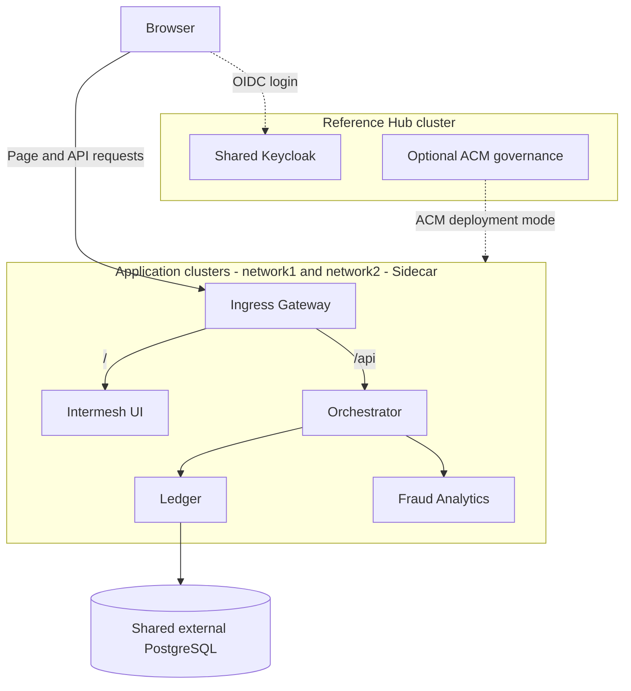

# Intermesh Bank

Intermesh Bank is a banking microservices demonstration for OpenShift Service
Mesh 3. A JavaScript frontend, Quarkus Orchestrator, Go Ledger, Python Fraud
Analytics service and Rust Proxy-Wasm plugin illustrate how application behavior
interacts with a multi-primary, multi-network Sidecar mesh.

## What it demonstrates

- Local and cross-network service communication through Istio gateways.
- HTTP traffic management and cookie-based consistent hashing for session affinity.
- Separate L4 workload-mTLS passthrough and L7 Orchestrator routing.
- Traffic fault injection, timeouts and controlled failure scenarios.
- Transaction-specific compensation and persisted transfer-request recovery
  without unsafe automatic financial POST retries.
- Keycloak login with PKCE, mesh and application JWT verification, authenticated
  session isolation and account-ownership checks.
- WasmPlugin request-header processing and its interaction with Fraud routing.
- Declarative deployment through ACM governance or standalone Kustomize profiles.

## Architecture

The diagram shows logical components replicated across two application clusters.
The reference topology has a third, dedicated Hub cluster hosting ACM and shared
Red Hat build of Keycloak. Both application clusters use one external PostgreSQL
database. ACM governance is optional; shared Keycloak is required in either
deployment mode. Standalone deployment does not require a dedicated ACM Hub;
Keycloak can run in a separately provisioned hosting environment.

The browser loads UI assets through `/` and sends bearer-authenticated `/api`
requests directly to Orchestrator through ingress. The UI server does not proxy
API requests. Solid arrows show application traffic; dashed relationships identify
SSO and governance. See the [deployment architecture](docs/deployment-architecture.md)
for cluster placement and request sequences.

## Getting started

Choose one deployment owner for each cluster:

| Mode | Guide | Public rendering from the repository root |
| --- | --- | --- |
| ACM | [Hub governance](deploy/acm/README.md) | `oc kustomize deploy/acm --enable-alpha-plugins` |
| Standalone | [OpenShift deployment without ACM](deploy/standalone/README.md) | `oc kustomize deploy/standalone/network1` and `oc kustomize deploy/standalone/network2` |

Public profiles contain deliberately nonfunctional image and endpoint placeholders.
Start with the [private configuration examples](docs/examples/README.md), configure
the shared values under Git-ignored `.local/`, and provision credentials separately.
There is no repository-root Kustomization. Rendering is offline preparation;
deployment requires the staged prerequisites and readiness checks in the guides.

## Documentation and repository map

| Path | Read it for |
| --- | --- |
| [Deployment architecture](docs/deployment-architecture.md) | Topology, application flow, placement and invariants |
| [Service mesh](service-mesh/README.md) | L4/L7 routing, discovery, affinity, security, Wasm and Fraud behavior |
| [OpenShift platform](platform/openshift/ossm/README.md) | Operator requirements, control planes and gateway workloads |
| [ACM deployment runbook](docs/acm-deployment-readiness.md) | Staged propagation and operational verification |
| [Standalone deployment](deploy/standalone/README.md) | OpenShift installation and validation without ACM |
| [Configuration examples](docs/examples/README.md) | Private values, Secret provisioning and Keycloak allowlists |
| [applications/](applications) | Shared workloads, per-network overlays and prerequisites |
| [src/](src) | Application and Wasm source code |

## Development and testing

Use the [development guide](docs/development.md) for toolchains and build/test
commands. The [Orchestrator guide](src/intermesh-orchestrator/README.md) covers
runtime configuration and signed-JWT tests. The
[local transfer integration test](src/intermesh-ledger/tests/README.md) exercises
the real Java → Go → PostgreSQL path using isolated synthetic fixtures.
