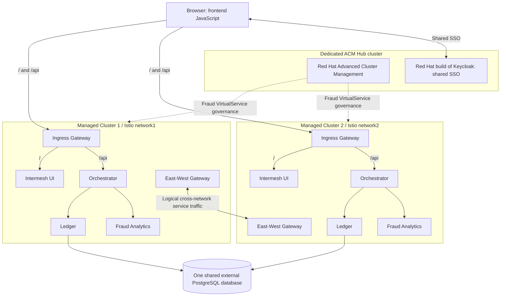

# intermesh-bank

## Architecture overview

The historical Sidecar demo used three OpenShift clusters: a dedicated ACM Hub
and two managed clusters, each normally running all four active components.

Solid links show traffic or logical routing capability; dashed links show ACM
management. Frontend JavaScript runs in the browser and calls `/api` through the
Ingress Gateway directly to Orchestrator; the UI workload serves `/`.
Cross-network service traffic traverses the East-West Gateways. Their link is
logical: workload-to-gateway hops and uncommitted L7 details are omitted, and
Orchestrator is not a mandatory hop for every cross-cluster request.
Cluster 1 uses `network1.session`, Cluster 2 uses `network2.session`,
and both preserve `JSESSIONID`. OSSM3 was installed manually; Channel Hub is inactive.
See [deployment architecture and resource placement](docs/deployment-architecture.md)
for ownership, prerequisites and still-unknown L7 Gateway configuration.

## Safe local configuration

Keep credentials and environment-specific configuration in the ignored root
`.local/` directory. Do not commit passwords, tokens, private keys, kubeconfigs or
cloud and registry credentials. Use newly generated credentials rather than any
values previously published in this repository.

Sanitized templates belong in [manifests/examples/](manifests/examples/README.md)
and should use names such as `postgres-secret.example.yaml` or `.env.example`.
Use obvious replacement markers and reserved example domains; an example filename
does not make its contents safe. Copy templates into `.local/` before filling in
actual values. Ignore rules do not load or inject configuration into applications.

These safeguards do not remove sensitive values already tracked by Git. Source
cleanup removes them from current files; Git history cleanup is a separate,
coordinated operation. Neither cleanup revokes credentials or erases existing
clones. If a published credential was reused elsewhere, handle that reuse
separately.
