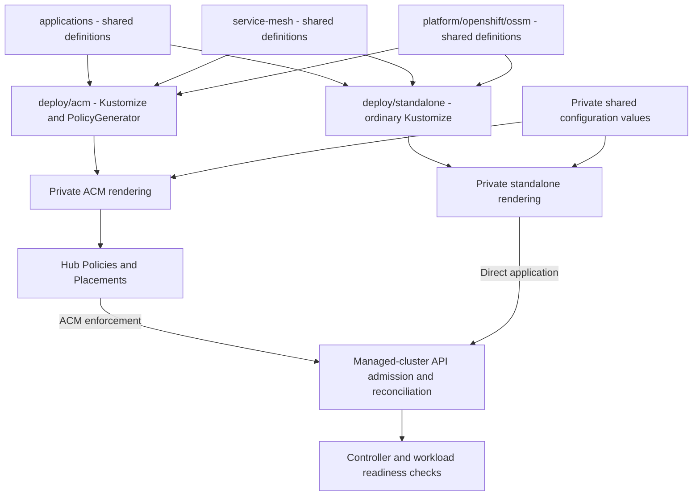

# Hub governance deployment

The [ACM entrypoint](kustomization.yaml) renders 55 Hub objects: 26 Policies,
26 PlacementBindings and three Placements. All parent and embedded remediation
settings are `enforce`. ACM reconciles selected managed-cluster resources from
the same definitions used by [standalone deployment](../standalone/README.md).

## Shared sources and deployment ownership



Choose one ownership path per resource. Do not apply standalone profiles or source
bases alongside ACM enforcement. Source definitions have no reverse dependency
on `deploy/`. Contained generator-input Kustomizations reference canonical directory
bases with normal load restrictions; they do not duplicate the resource definitions.

PolicyGenerator embeds desired resources into ConfigurationPolicies; the Operator
Policy is defined directly. Kustomize aggregates those Policies, their bindings and
the central Placements. Local generation does not contact a cluster. After Hub
application, Placement selects targets and ACM propagates/reconciles the declared
resources. Kubernetes API admission and the relevant OLM, Sail, Istio and workload
controllers are separate steps. Policy compliance reports desired-state agreement,
not working network paths or application readiness.

## Rendering layers

From the repository root, using a trusted installed PolicyGenerator plugin:

```sh
oc kustomize deploy/acm --enable-alpha-plugins
oc kustomize .local/deploy/acm --enable-alpha-plugins
```

Public and private outputs have the same 55 identities and enforcement modes.
Public images and endpoints are nonfunctional placeholders. Configure the nine
shared values in `.local/configuration/values/values.yaml` before using private
output; provision credentials separately. See the
[configuration examples](../../docs/examples/README.md#private-deployment-configuration).

The private layer validates embedded identities, placeholders, container/environment
positions and ordering before native replacements configure images, external
endpoints, OIDC and Wasm. The values ConfigMap is a rendering carrier omitted from
deployment output. Ordinary Deployment patches do not reach resources embedded
inside Policies. Preserve the guards and compare configured definitions with
matching private standalone renderings.

## Enforcement and ownership

| Governance group | Responsibility |
| --- | --- |
| [Operator](policies/platform/operator/README.md) | OSSM Operator subscription and health through OperatorPolicy. |
| [Namespaces](policies/platform/namespaces/README.md), [identity](policies/platform/network-identity/README.md), [CNI](policies/platform/cni/README.md), [control planes](policies/platform/control-plane/README.md) | Infrastructure prerequisites and per-network mesh configuration. |
| [Ingress](policies/platform/gateways/ingress/README.md), [East-West](policies/platform/gateways/eastwest/README.md) | Kubernetes gateway workloads and their RBAC/scaling resources. |
| [Applications](policies/applications/README.md) | Foundation Namespaces/ServiceAccounts and four Deployment/Service pairs per network. |
| [Networking and security](policies/service-mesh/README.md) | Logical Gateways, routes, affinity, discovery and security. |
| [Wasm](policies/service-mesh/wasm/README.md) | The Orchestrator WasmPlugin. |

ConfigurationPolicies use `musthave`, with pruning and recreation disabled.
Shared Policies use `placement-all-clusters`, selected by `ossm-enabled: "true"`.
Network-specific Policies use `placement-intermesh-network1` or
`placement-intermesh-network2`, also requiring the corresponding `ossm-network`
value. These are project-defined ManagedCluster labels, not Istio network labels.
Verify ClusterSet access and PlacementDecisions; do not select the Hub.

Each network receives only its matching control plane, gateway Policies, application
`NETWORK` patch, ingress-routing Policy and Orchestrator DestinationRule. The
[dependency inventory](../../docs/acm-deployment-readiness.md#policy-dependencies-and-runtime-gates)
records same-cluster Policy prerequisites. Shared Policies cannot depend on both
mutually exclusive network-specific control planes. Explicit dependencies order
configuration eligibility without proving controller readiness.

The application foundation retains the inactive Channel Hub ServiceAccount, but no
Channel Hub workload or AuthorizationPolicy is deployed. RHBK and PostgreSQL are
external dependencies; Keycloak RealmImport provisioning is independent of this
aggregate. Gateway workload Policies create Kubernetes resources; separate logical
Gateway and VirtualService Policies configure their traffic behavior.

## Prerequisites and runtime checks

Use the [staged deployment runbook](../../docs/acm-deployment-readiness.md) rather
than treating the complete 55-object rendering as an unattended cold-start installer.
It covers Hub access and labels, Operator/CRD readiness, CNI, shared trust, control
planes, gateways, remote discovery, external dependencies and functional checks.
The target baseline is ACM 2.17 and OSSM 3.4 Sidecar on supported OpenShift/RHCOS 9.x;
Istio/CNI versions are not pinned by the custom resources.

Each managed cluster needs Secret `intermesh-backend/intermesh-ledger-db`, key
`DATABASE_URL`, pointing to the one shared database. Images and the Wasm OCI artifact
must be published and accessible. Keycloak issuer, JWKS, claims, browser origins and
TLS trust must agree. Public HTTPS termination, redirects and effective application
cookie attributes must be resolved before public exposure.

Application Deployments declare one replica. ACM can reverse manual scaling, so
use the [ownership-aware outage procedure](../../docs/acm-deployment-readiness.md#workload-unavailability-and-restoration).
The Ingress default ServiceAccount has namespace-wide Secret-reading access;
restrict that namespace. Gateway injection and OpenShift admission determine actual
Pod settings beyond source fields. Use the gateway group guides for details.

Offline rendering validates composition and source equivalence. It does not prove
live ACM admission, placement, mesh enforcement, image access or runtime readiness.
