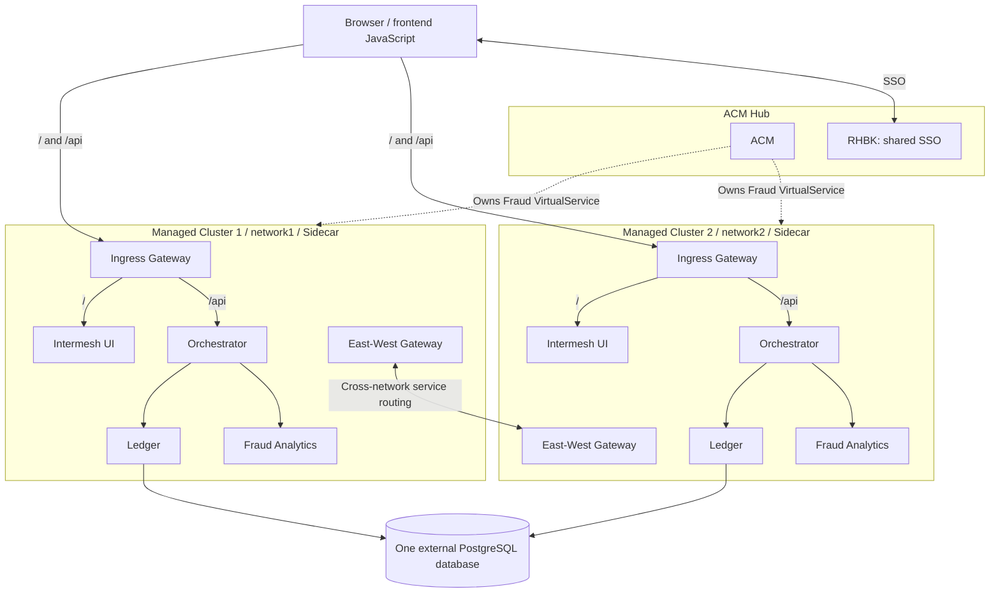

# Deployment architecture

Intermesh Bank runs across two OpenShift managed clusters in a multi-primary,
multi-network OpenShift Service Mesh 3 deployment. A third cluster hosts ACM
governance and shared Keycloak SSO. Sidecar is the reference data plane.

## Cluster roles

| Cluster | Network | Components |
| --- | --- | --- |
| ACM Hub | Outside the managed application meshes | Red Hat Advanced Cluster Management, Red Hat build of Keycloak (RHBK) and its Operator. |
| Managed Cluster 1 | `network1` | Intermesh UI, Orchestrator, Ledger and Fraud Analytics. |
| Managed Cluster 2 | `network2` | Intermesh UI, Orchestrator, Ledger and Fraud Analytics. |

These names identify deployment roles rather than kubeconfig contexts.
Both managed clusters use the same external PostgreSQL database. RHBK runs in
the Hub's `keycloak` namespace and serves both frontends from outside their meshes.

## Request flow



The browser loads frontend assets through `/`. Frontend JavaScript sends API
requests to `/api` on the same origin; ingress routes them directly to
Orchestrator. The UI workload does not proxy API requests. Orchestrator is the
backend entry point and calls Ledger and Fraud Analytics.

Solid links show traffic or logical routing capability; dashed links show
management. Cross-network service traffic traverses the appropriate East-West
Gateways. The gateway link summarizes that capability, omitting individual
workload-to-gateway hops and L7 details. It does not imply direct cross-network
Pod connectivity or require every cross-cluster request to pass through
Orchestrator.

Both managed clusters normally run all four active workloads. Demonstrations
can stop selected workloads to exercise cross-network routing: an Orchestrator
in Cluster 2 can reach Ledger in Cluster 1 when the local Ledger is unavailable.
Both Ledger instances use the same database; this is service routing rather than
database replication.

Channel Hub is inactive. Its source, manifests, service account and Keycloak
client remain available for future use, but it is not a runtime dependency or an
authentication boundary in this architecture.

## Resources and ownership

### Application workloads

The following Deployment and Service pairs run in both managed clusters:

| Manifest | Namespace |
| --- | --- |
| [intermesh-ui.yaml](../manifests/intermesh-ui.yaml) | `intermesh-frontend` |
| [intermesh-orchestrator.yaml](../manifests/intermesh-orchestrator.yaml) | `intermesh-backend` |
| [intermesh-ledger.yaml](../manifests/intermesh-ledger.yaml) | `intermesh-backend` |
| [fraud-analytics.yaml](../manifests/fraud-analytics.yaml) | `intermesh-backend` |

[namespaces.yaml](../manifests/namespaces.yaml) requests sidecar injection.
The [frontend service account](../manifests/intermesh-frontend-sa.yaml) and
[backend service accounts](../manifests/intermesh-backend-sa.yaml) provide local
workload identities. Injection also requires a configured mesh installation.
[intermesh-channel-hub.yaml](../manifests/intermesh-channel-hub.yaml) and its
retained service account are excluded from the active deployment.

### ACM governance and mesh routing

ACM Policy, Placement and PlacementBinding objects live on the Hub in
`open-cluster-management-policies`. Their generated Istio resources live in the
managed clusters. RHBK provisioning is separate and uses the Hub's `keycloak`
namespace.

| Manifest | Role |
| --- | --- |
| [acm-fraud-analytics-vs.yaml](../manifests/ossm/acm-fraud-analytics-vs.yaml) | ACM owner of `intermesh-backend/fraud-analytics-chaos` VirtualService in both managed clusters; references `placement-all-clusters`. |
| [istio-gateway.yaml](../manifests/ossm/istio-gateway.yaml) | ACM Policy containing Gateway definitions in `istio-ingress` and `istio-east-west`, plus `placement-all-clusters` and its binding. The Placement selects `ossm-enabled: "true"`. |
| [virtual-service.yaml](../manifests/ossm/virtual-service.yaml) | Ingress routes: `/api` to Orchestrator and `/` to UI, in `istio-ingress`. |
| [virtual-service-east-west.yaml](../manifests/ossm/virtual-service-east-west.yaml) | East-West routes for `/api`, `/v2/fraud`, `/v1/ledger` and `/`, in `istio-east-west`. |

The standalone [fraud-analytics-vs.yaml](../manifests/ossm/fraud-analytics-vs.yaml)
defines the same resource as the ACM policy with different header matching.
It is excluded from the active deployment to avoid competing ownership.
Keep the fraud header matching, fault injection and timeout relationships
together when changing this demonstration.

### Authentication and authorization

[RequestAuthentication](../manifests/ossm/jwt-request-authentication.yaml)
selects Orchestrator, configures the issuer and JWKS URL, and forwards the original
token. The [JWT AuthorizationPolicy](../manifests/ossm/jwt-authorization-policy.yaml)
uses the issuer principal prefix.

The remaining policy files describe workload and gateway identities:

- [allow-hub-to-orchestrator.yaml](../manifests/ossm/policies/allow-hub-to-orchestrator.yaml)
  declares `allow-ingress-to-orchestrator` for ingress/East-West namespaces;
  its filename does not introduce a Channel Hub dependency.
- [allow-ingress-to-ui-api.yaml](../manifests/ossm/policies/allow-ingress-to-ui-api.yaml)
  contains UI and retained Channel Hub selectors.
- [allow-orchestrator-to-ledger.yaml](../manifests/ossm/policies/allow-orchestrator-to-ledger.yaml)
  and [allow-orchestrator-to-analytics.yaml](../manifests/ossm/policies/allow-orchestrator-to-analytics.yaml)
  reference Orchestrator and East-West Gateway principals.
- [allow-ledger-to-db.yaml](../manifests/ossm/policies/allow-ledger-to-db.yaml)
  references the external database host and Ledger principal.

Effective authorization depends on workload selectors and the combined policies;
the database policy alone does not establish outbound database enforcement.

### Service identities

Internal ServiceEntries describe service, workload and East-West Gateway
identities. Keep their SPIFFE identities aligned with service accounts and
authorization policies.

| Namespace | ServiceEntry manifests |
| --- | --- |
| `intermesh-frontend` | [UI](../manifests/ossm/serviceentry/intermesh-ui-se.yaml) |
| `intermesh-backend` | [Orchestrator](../manifests/ossm/serviceentry/intermesh-orchestrator-se.yaml), [Ledger](../manifests/ossm/serviceentry/intermesh-ledger-se.yaml), [Fraud Analytics](../manifests/ossm/serviceentry/fraud-analytics-se.yaml) |
| `intermesh-backend` | [Channel Hub (inactive)](../manifests/ossm/serviceentry/intermesh-channel-hub-se.yaml) |

External ServiceEntries in `intermesh-backend` declare
[PostgreSQL](../manifests/ossm/serviceentry/serviceentry-db.yaml) on TCP/5432 and
[Keycloak](../manifests/ossm/serviceentry/serviceentry-keycloak.yaml) on HTTPS/443
as `MESH_EXTERNAL` services.

## Configuration

### Shared PostgreSQL

Each managed cluster needs a Secret named `intermesh-ledger-db` in
`intermesh-backend`, with key `DATABASE_URL`. The two Secrets may contain the
same complete connection string for the single shared database. Preserve the
database name, schema/search-path options, TLS settings and connection semantics;
there are no per-cluster databases, schemas or synchronization mechanisms.

The hostname in `DATABASE_URL`, the PostgreSQL ServiceEntry and the database
policy host reference must agree. Use the
[PostgreSQL Secret example](../manifests/examples/postgres-secret.example.yaml)
and keep actual values in protected local configuration.

### Keycloak SSO and realm provisioning

The Hub hosts [KeycloakRealmImport](../manifests/keycloak/realmimport.yaml)
and Secret `intermesh-keycloak-credentials` in namespace `keycloak`, alongside
Keycloak CR `keycloak`. The import uses API `k8s.keycloak.org/v2alpha1`.
The selected Operator/CRD must support `spec.placeholders`; its version is not
pinned in the repository.

The provisioning Secret supplies five keys: `HUB_CLIENT_SECRET`,
`DEMO_USER_1_PASSWORD`, `DEMO_USER_2_PASSWORD`, `DEMO_USER_3_PASSWORD` and
`DEMO_ADMIN_PASSWORD`. It is needed only on the Hub, not in the managed clusters.
Use the [Keycloak Secret example](../manifests/examples/keycloak-credentials.secret.example.yaml)
and [local provisioning instructions](../manifests/examples/README.md).
RealmImport creates new realms; changing its Secret does not rotate credentials
in an already imported realm.

The realm is `intermesh-bank`, with frontend client `intermesh-frontend` and
retained inactive client `intermesh-channel-hub`. The three banking usernames
match [SQL fixtures](../sql/001.sql). Keep all four realm users, profiles, roles,
groups, credential flags and their fixture relationships intact.

Changing the shared SSO endpoint requires coordinated updates to:

- UI `KEYCLOAK_URL`, consumed by the
  [startup substitution script](../intermesh-ui/src/00-substitute-env.sh).
- RequestAuthentication issuer and JWKS URL, AuthorizationPolicy principal prefix,
  and the Keycloak ServiceEntry host.
- Retained Channel Hub `KEYCLOAK_ISSUER` configuration, if maintained.

Realm/client identifiers, issuer semantics and login flows remain unchanged.

### Session affinity

Each managed cluster uses exactly one Orchestrator DestinationRule:

| Cluster | DestinationRule | Affinity cookie |
| --- | --- | --- |
| Cluster 1 / `network1` | [orchestrator-network1-dr.yaml](../manifests/ossm/destination-rules/network1/orchestrator-network1-dr.yaml): `intermesh-orchestrator-dr-network1` | `network1.session`, TTL `0s` |
| Cluster 2 / `network2` | [orchestrator-network2-dr.yaml](../manifests/ossm/destination-rules/network2/orchestrator-network2-dr.yaml): `intermesh-orchestrator-dr-network2` | `network2.session`, TTL `0s` |

Both target `intermesh-orchestrator.intermesh-backend.svc.cluster.local` in
`intermesh-backend`. They do not select themselves by network, so deploying both
to one cluster creates competing traffic policies.

`JSESSIONID` identifies the application session stored locally by Orchestrator and is separate from network affinity.
[application.properties](../intermesh-orchestrator/src/main/resources/application.properties)
and [VertxSessionConfig.java](../intermesh-orchestrator/src/main/java/it/intermesh/bank/util/VertxSessionConfig.java)
configure the session and local session store. Preserve all three cookies and
their forwarding across Gateway hops.

### WasmPlugin

[wasmplugin.yaml](../manifests/ossm/wasmplugin.yaml) selects
`app: intermesh-orchestrator` in `intermesh-backend` and uses
`failStrategy: FAIL_OPEN`. Its OCI artifact is
`security-headers-wasmplugin:1.0`; the manifest specifies the full image locator.
Deploy the plugin alongside Orchestrator in both managed clusters.

The [Rust implementation](../security-headers-wasmplugin/src/lib.rs) checks
HTTP `:authority` for `fraud-analytics` and sets `x-intermesh-channel` and
`x-intermesh-route-class`. Its `Web-Channel-Hub` value is a routing marker,
not an active Channel Hub dependency. Keep these markers and authority semantics
aligned with fraud routing.

Use the existing [image packaging](../security-headers-wasmplugin/Containerfile)
when publishing the artifact. Registry relocation requires updating the
WasmPlugin's `spec.url`; a workload image override does not update that field.

## Local Kustomize rendering

Render each target independently from the repository root:

```sh
# ACM Hub governance
oc kustomize manifests/ossm
# ACM Hub Keycloak provisioning
oc kustomize manifests/keycloak
# Managed Cluster 1 / network1
oc kustomize overlays/managed-cluster-1
# Managed Cluster 2 / network2
oc kustomize overlays/managed-cluster-2
```

`kubectl kustomize` can be used in place of `oc kustomize`. These commands render
local manifests without contacting a cluster or deploying resources.
The managed-cluster overlays combine the shared base in
[manifests/kustomization.yaml](../manifests/kustomization.yaml) with exactly one
network-specific DestinationRule. The Hub governance and Keycloak entrypoints
are independent of that base.

The renderings exclude Secret examples, the inactive Channel Hub Deployment,
Service and ServiceEntry, and the standalone Fraud Analytics VirtualService.
Existing inactive Channel Hub service-account and authorization-policy objects
remain in shared source files; they do not activate a workload. Provision the
database Secrets in both managed clusters and the Keycloak credential Secret
on the Hub separately.

## Deployment prerequisites

OSSM3 installation and configuration are managed manually in each managed
cluster. The repository contains application and policy resources, but not a
complete cluster provisioning workflow. The Kustomize entrypoints compose
existing resources without changing endpoints or images. Environment-specific
overrides and ACM automation for mesh installation and application deployment
remain future work.

A deployment also needs environment-specific configuration for:

- Cluster/context names, mesh and cluster IDs, network advertisements, and ACM
  ManagedCluster names and labels.
- OSSM3 versions and installation settings, trust certificates, remote discovery
  Secrets and inter-cluster connectivity.
- Ingress and East-West Gateway addresses, Routes, DNS, certificates and the
  complete L7 Gateway configuration.
- RHBK server/Operator/CRD versions and installation resources, PostgreSQL
  provisioning, protected Secret values and available container/Wasm images.

The Gateway manifests do not include the complete L7 East-West configuration
used by the demo. Its additional resources, placement, controller ownership,
SNI, authority rewrites and TLS settings need to be supplied before reproducing
that setup. The diagrams describe logical routing rather than those settings.

Keep service names, namespaces, ports, selectors, service accounts and
`cluster.local`/SPIFFE identities consistent. Gateway names, wildcard hosts,
route ordering and HTTP authority/SNI values can be routing identities rather
than replaceable infrastructure addresses. Deploy resources by cluster and
controller ownership rather than applying the entire manifests directory
recursively.

The Orchestrator manifest's environment-variable names differ from its REST
client configuration keys. Effective overrides and port selection require
integration testing; keep existing internal defaults when configuring endpoints.

Validate the deployment across both managed clusters with Hub-hosted SSO and ACM
governance. Cover browser login, direct API routing, session affinity across
Gateway hops, shared Ledger data, fraud behavior and temporary workload
unavailability. Replica counts, shutdown sequences and the additional L7
configuration are deployment-specific. Offline manifest checks cannot validate
these runtime behaviors.
