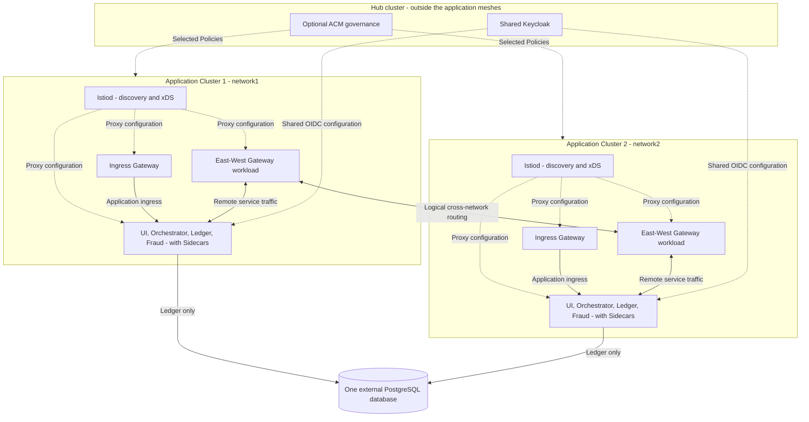
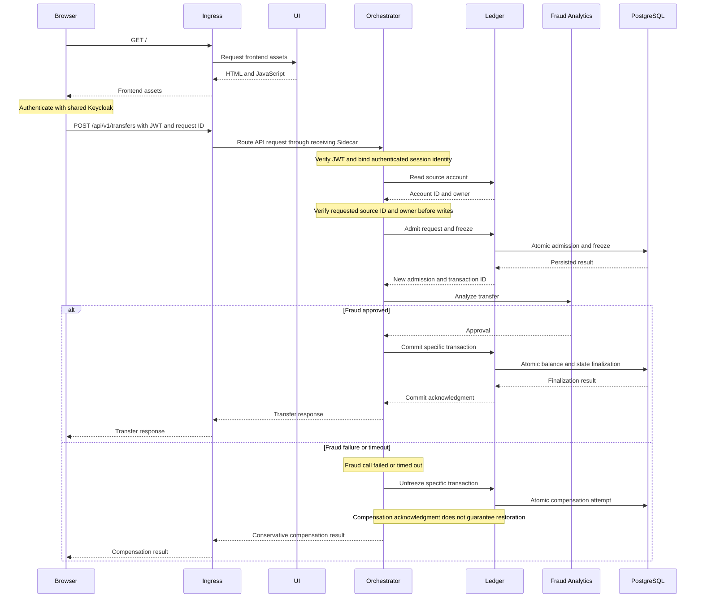

# Deployment architecture

Intermesh Bank uses two OpenShift clusters in a multi-primary, multi-network
OSSM Sidecar mesh. The reference topology includes a dedicated Hub cluster
hosting shared Keycloak SSO and optional ACM governance. Deployment ownership
can instead be standalone; the application and mesh definitions are shared.
Standalone needs shared Keycloak but does not require a dedicated ACM Hub cluster.
Hub placement below describes the reference topology.

## Multicluster topology

Solid links represent application traffic or logical routing capability; dashed,
labelled links distinguish management, proxy configuration and OIDC dependencies.
The East-West link summarizes connectivity, not a required hop through both gateway
Pods. Cross-network service calls traverse the appropriate gateway rather than
assuming direct Pod-to-Pod connectivity.

Each network has one East-West workload selected by two Istio Gateways on 15443:
L4 `AUTO_PASSTHROUGH` for Ledger/Fraud/UI hosts, and a dedicated Orchestrator L7
`ISTIO_MUTUAL` path. There is no separate L7 gateway Deployment. See
[mesh routing](../service-mesh/README.md#ingress-and-east-west-routing) for the
host matching and authority rewrite.

Shared-root trust, per-cluster signing material, reciprocal remote-discovery
credentials and reachable remote Kubernetes APIs are external prerequisites.
The sources do not provision them or establish effective Envoy listeners.

## Placement and ownership

| Location | Components |
| --- | --- |
| Hub, `open-cluster-management-policies` | ACM Policies, Placements and PlacementBindings in ACM mode. |
| Hub, `rhbk` | RHBK and its Operator, Keycloak CR, provisioning Secret and RealmImport. Only the RealmImport is supplied here. |
| Each cluster, `intermesh-frontend` | UI Deployment, Service and ServiceAccount. |
| Each cluster, `intermesh-backend` | Orchestrator, Ledger and Fraud Deployments/Services; backend ServiceAccounts, Ledger database Secret and applicable Istio resources. |
| Each cluster, OSSM namespaces | Control plane, CNI, Ingress and East-West workloads. |
| Outside OpenShift | One shared PostgreSQL database. |

Both clusters normally run all four active application workloads. An Orchestrator
can use a remote Ledger or Fraud endpoint when the local workload is unavailable;
this is service routing, not database replication. Under ACM, coordinate outages
with desired replica values because enforcement can reverse manual scaling. Use
[workload unavailability and restoration](acm-deployment-readiness.md#workload-unavailability-and-restoration).

Channel Hub is inactive. Its source code and ServiceAccount are retained, but it
has no deployed workload, Service, AuthorizationPolicy or imported Keycloak client
and is not an authentication boundary in the active path.

### Resource sources

| Shared source | Responsibility |
| --- | --- |
| [Application prerequisites](../applications/prerequisites/kubernetes/kustomization.yaml) | Two application Namespaces with injection requested, and five ServiceAccounts. |
| [Application base](../applications/base/kustomization.yaml) | Four Deployment/Service pairs; [network1](../applications/overlays/network1/kustomization.yaml) and [network2](../applications/overlays/network2/kustomization.yaml) add the Orchestrator `NETWORK` diagnostic value. |
| [Platform overlays](../platform/openshift/ossm/README.md) | Four infrastructure Namespaces, IstioCNI, Istio and Ingress/East-West workloads: 17 resources per network. |
| [Mesh resources](../service-mesh/README.md#resource-groups-and-rendering) | Gateways, routes, discovery, one matching DestinationRule, security and Wasm: 18 resources per network. |
| [Keycloak provisioning](../applications/prerequisites/dependencies/keycloak/kustomization.yaml) | One independent RealmImport for the hosting environment. |

[Standalone profiles](../deploy/standalone/README.md) compose 50 ordinary resources
per network: seven application prerequisites, eight workloads, 17 platform and
18 mesh resources. [ACM](../deploy/acm/README.md) governs the same definitions
through 26 Policies, 26 PlacementBindings and three Placements on the Hub.
ACM inputs reference contained directory wrappers; resource definitions are not
copied into a parallel application base. Choose one deployment owner per resource.

The Fraud VirtualService is ACM-owned in ACM mode and directly managed in
standalone mode. RHBK provisioning is independent of either application deployment
mode; the governance aggregate does not install Keycloak or PostgreSQL.

## Browser and API routing

The browser loads frontend assets through `/`. JavaScript sends bearer-authenticated
requests to `/api` on the same origin, which ingress routes directly to Orchestrator.
The UI workload serves static assets and does not forward API requests.

The [ingress VirtualService](../service-mesh/traffic-management/virtual-services/ingress/virtual-service.yaml)
preserves the API path and rewrites its authority to
`intermesh-orchestrator.session.intermesh.com`. That routing identity coordinates
with the [Orchestrator East-West route](../service-mesh/traffic-management/virtual-services/orchestrator/orchestrator-east-west-virtualservice.yaml).
Service port 80 maps to Orchestrator workload port 8080. Diagnostic `/hello` routes
exist in Java but are not exposed by the committed ingress API route.

### Transfer request sequence

This sequence follows a newly admitted transfer. Calls from Orchestrator to Ledger
and Fraud are synchronous HTTP calls; there is no background transfer worker.

The [transfer workflow](../src/intermesh-orchestrator/src/main/java/it/intermesh/bank/orchestrator/TransferOrchestrator.java)
retains the transaction ID from admission for commit and compensation. Ledger
finalizes only that transaction using exact monetary values. Commit failures can
also trigger compensation; an ambiguous commit may already have succeeded, so
compensation is not proof that funds were restored. An acknowledged unfreeze is
reported as acknowledged, not independently verified restoration. An explicit
failure leaves restoration unconfirmed; a timeout or lost response leaves the
outcome unknown.

A replay or persisted admission result can return before Fraud/commit, without
repeating the financial workflow. The browser retains request intent in
sessionStorage and can query `/api/v1/transfer-requests/{transfer_request_id}`.
Recovery is a read of persisted state, not an automatic POST retry. Duplicate
confirmation is explicit. The workflow records the destination but does not
implement recipient settlement.

## Authentication and application sessions

The shared Keycloak realm is `intermesh-bank`, with public client
`intermesh-frontend`. The browser uses authorization code flow with PKCE S256.
At the receiving Orchestrator Sidecar, RequestAuthentication validates JWTs and
forwards the original token. A workload-scoped DENY requires a validated request
principal on all incoming port-8080 traffic, including diagnostic paths.

Quarkus independently verifies the current bearer JWT. Its banking identity uses
`(iss, sub)` and the verified `preferred_username` owner key. Banking operations
bind local application sessions to that subject and enforce account ownership
independently of affinity. Ledger and Fraud authorize the Orchestrator workload
principal; browser JWTs are not automatically forwarded to Ledger. See the
[security flow and manifests](../service-mesh/README.md#authentication-and-authorization).

Each cluster selects exactly one network-specific Orchestrator DestinationRule:

| Network | Rule | Affinity cookie |
| --- | --- | --- |
| `network1` | [intermesh-orchestrator-dr-network1](../service-mesh/traffic-management/destination-rules/network1/orchestrator-network1-dr.yaml) | `network1.session`, TTL `0s` |
| `network2` | [intermesh-orchestrator-dr-network2](../service-mesh/traffic-management/destination-rules/network2/orchestrator-network2-dr.yaml) | `network2.session`, TTL `0s` |

`JSESSIONID` identifies the application session stored locally by Orchestrator and
is separate from network affinity. See [session affinity](../service-mesh/README.md#session-affinity)
for cookie generation, failover and session-isolation behavior.

## Shared dependencies and configuration

### PostgreSQL

All Ledger workloads use one external database. Each managed cluster requires
Secret `intermesh-backend/intermesh-ledger-db`, key `DATABASE_URL`; both Secrets
can contain the same connection string. Preserve database name, schema/search-path
options, TLS settings and connection semantics. The hostname must agree with the
PostgreSQL ServiceEntry. There are no per-cluster databases or synchronization
mechanisms. PostgreSQL egress isolation is not configured.

The [SQL sources](../applications/prerequisites/dependencies/postgresql) define
accounts, transactions and transfer requests with `NUMERIC(15,2)` amounts. The
repository does not pin a PostgreSQL server major version; the configured database
must support the schema, transactional row/advisory locking and required privileges.
Initialize with `001.sql`, `002.sql` and `003-transfer-requests.sql`, in that order.
The demo data is disposable; use the [database reset procedure](../applications/prerequisites/dependencies/postgresql/README.md#reinitializing-the-demo)
to replace it while preserving database infrastructure and roles.
See [credential provisioning](examples/README.md#shared-postgresql-database).

### Keycloak

The [RealmImport](../applications/prerequisites/dependencies/keycloak/realmimport.yaml)
uses `k8s.keycloak.org/v2beta1`, Keycloak CR `keycloak` and Secret
`intermesh-keycloak-credentials` in the Hub's `rhbk` namespace. Four Secret-backed
placeholders supply the demo-user passwords. The import defines only the
`intermesh-frontend` OIDC client. The RHBK 26.6 Operator/CRD must serve this API
and support `spec.placeholders`;
Operator installation is separate. RealmImport initially creates a realm and does not
reconcile later client or credential changes into an existing realm.

Both frontends use one canonical issuer and distinct environment origins.
The public frontend client requires PKCE S256 and disables direct access grants.
[Shared private configuration](examples/README.md#shared-keycloak-endpoint) keeps
UI startup substitution, Quarkus issuer, Istio issuer/JWKS/principal and Keycloak
ServiceEntry host aligned. Frontend login redirects and Web Origins use wildcards
for demo portability. Logout uses `post.logout.redirect.uris: "+"` to inherit the
login redirect allowlist, so no frontend origin configuration is required. See the
[demo security note](examples/README.md#hub-keycloak-provisioning-overlay).
Effective access-token scopes must
provide the verified `preferred_username` used by the account fixtures.

## Deployment prerequisites and invariants

Use the [platform guide](../platform/openshift/ossm/README.md), the appropriate
[ACM runbook](acm-deployment-readiness.md) or
[standalone installation sequence](../deploy/standalone/README.md#staged-installation),
and [private examples](examples/README.md). Required environment inputs include
published application/Wasm artifacts, external endpoints, credentials, shared
mesh trust, remote discovery, gateway addresses and DNS/TLS configuration.

Preserve service names, namespaces, selectors, workload ServiceAccounts, trust
domain, authority/SNI identifiers, route order and network-specific cookies.
Cluster IDs `cluster1`/`cluster2` are Istio identities, not assumed ACM registration
names or kubeconfig contexts. Sidecar is the reference data plane; no Ambient
profile is supplied.

Public HTTPS-only access and effective custom session-cookie attributes require
an approved deployment configuration. Application health endpoints/probes are not
provided by the session handler's health-path bypass. Offline rendering establishes
source composition. Follow the
[operational verification matrix](acm-deployment-readiness.md#functional-verification-matrix)
for deployment acceptance checks.
