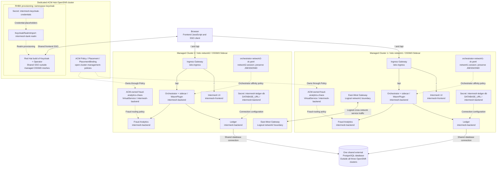

# Deployment architecture and resource placement

This document records the original Sidecar demonstration topology confirmed by
the deployment owner, alongside the committed resource definitions. It is not an
installation procedure or an independently verified runtime reconstruction. No
concrete infrastructure addresses or credentials are reproduced here.

## 1. Evidence and architectural context

- **Confirmed historical deployment, supplied by the owner:** exactly three
  OpenShift clusters existed: a dedicated ACM Hub, Managed Cluster 1 using Istio
  `network1`, and Managed Cluster 2 using Istio `network2`. The managed clusters
  formed the multi-primary, multi-network application mesh. UI, Orchestrator,
  Ledger and Fraud Analytics normally ran in both managed clusters; Channel Hub
  was not deployed in the active architecture. Both managed clusters accessed
  one shared external PostgreSQL database. RHBK and its Operator ran on the Hub,
  providing one shared Identity Provider outside both managed OSSM3 meshes.
- **Verified repository facts:** the resource definitions and application
  configuration referenced below are committed. Their presence establishes their
  declared behavior. Historical placement and ownership confirmations come from
  the owner, not from filenames alone. Secret references describe the current
  cleaned repository; they do not prove the same credential mechanism was used
  in the original deployment.
- **Still unknown:** physical cluster/context names, exact installation settings,
  external addresses and the complete additional L7 East-West configuration.
  Logical network assignments are now confirmed; missing details must not be
  inferred by replacing every hostname-like string.

OSSM3 was manually installed and configured in each managed cluster because of
time constraints. Automating OSSM3 installation and application deployment through
ACM was planned but not completed. The active ACM Fraud Analytics policy does not
mean ACM automated the complete mesh or application installation. Future overlays
or ACM installation automation are proposed work, not historical deployment facts.

## 2. Active application and request flow

The confirmed topology and normal logical API paths are:

```text
Dedicated ACM Hub cluster
  ACM governance: Policies / Placement / PlacementBindings -> managed clusters
  RHBK + Operator (namespace keycloak): shared SSO for both managed UIs

Managed Cluster 1 (network1)          Managed Cluster 2 (network2)
  UI -> Ingress -> Orchestrator        UI -> Ingress -> Orchestrator
                    |-> Ledger                          |-> Ledger
                    |-> Fraud Analytics                 |-> Fraud Analytics
           <--------- East-West service routing --------->
                    Ledger workloads in both clusters
                                  |
                         one external PostgreSQL
```

The Orchestrator is the backend entry point in each managed cluster. The UI uses
its current browser origin for API requests and the Hub-hosted RHBK service for
frontend login. Committed ingress routing sends `/api` directly to the Orchestrator
and `/` to the UI. RHBK is external to the managed application meshes even though
it runs on another OpenShift cluster in the same demonstration environment.

During demonstrations, selected workloads were temporarily stopped to exercise
cross-cluster routing. For example, stopping Ledger in Managed Cluster 2 did not
prevent its Orchestrator from reaching Ledger in Managed Cluster 1. This is an
owner-confirmed historical observation, not a test reproduced from this checkout.
It demonstrates service routing to a remote workload, not database replication.

The Channel Hub's source, Deployment, Service, service account, mesh definitions
and confidential Keycloak client remain in the repository for possible future
use. They do not establish an active dependency or authentication boundary.
Do not activate the Hub or insert it into this request path.

The diagram is logical, not a physical cross-cluster hop diagram. Application
sidecars and the appropriate East-West Gateways carry cross-network service traffic.
Preserve the Sidecar baseline; do not substitute a different mesh data plane.

The deployment view below separates Hub governance from RHBK provisioning and
shows the normal resource placement. The browser runs frontend JavaScript;
the UI workload serves frontend assets rather than forwarding API requests.
East-West Gateway nodes represent logical cross-network transport, without
specifying uncommitted L7 configuration.



Solid links show application/SSO/database traffic or logical East-West routing;
dashed links show management, provisioning or configuration relationships, not
application hops. Browser requests for `/` reach UI; `/api` reaches Orchestrator
directly through ingress. Cross-network service traffic traverses the appropriate
East-West Gateways, rather than a direct cross-network Pod-to-Pod link. The
gateway-to-gateway edge summarizes that capability; workload-to-gateway hops,
SNI, authority rewrites and TLS configuration are not specified. It does not
require all cross-cluster requests to pass through Orchestrator.
The affinity policy nodes identify each cluster's exclusive
DestinationRule; `JSESSIONID` remains a separate application-session cookie.
Both database Secrets may contain the same connection configuration. The
standalone Fraud Analytics VirtualService and inactive Channel Hub are omitted
from this active profile. OSSM3 installation was manual in each managed cluster;
the ACM links do not imply automated mesh or application installation.

## 3. Shared dependencies and required Secrets

| Resource | Required contents and placement |
| --- | --- |
| One shared external PostgreSQL database | All Ledger workloads use the same database. Preserve database name, schema/search-path options, TLS settings and other connection semantics. No per-cluster databases, schemas, replication or synchronization are introduced. |
| Secret `intermesh-ledger-db` | Key `DATABASE_URL`, in namespace `intermesh-backend` in each cluster running Ledger. These are separate Kubernetes objects and may contain the identical complete connection string for the shared database. |
| One shared RHBK SSO service on the ACM Hub | Preserve realm `intermesh-bank`, frontend client `intermesh-frontend` and retained client `intermesh-channel-hub`. RHBK is outside both managed OSSM3 meshes and serves both frontends. |
| Secret `intermesh-keycloak-credentials` | On the ACM Hub in namespace `keycloak`, alongside the Keycloak CR and RealmImport. Required keys are `HUB_CLIENT_SECRET`, `DEMO_USER_1_PASSWORD`, `DEMO_USER_2_PASSWORD`, `DEMO_USER_3_PASSWORD` and `DEMO_ADMIN_PASSWORD`. This is a realm-provisioning input, not an active application runtime dependency. |

Do not replicate the Keycloak provisioning Secret into the managed clusters
merely because they consume shared SSO. Its namespace and referenced Keycloak CR
must exist on the Hub. Keep ACM governance resources separate from RHBK
provisioning resources: both live on the Hub, but the committed governance objects
use `open-cluster-management-policies`, while RealmImport and its Secret use
`keycloak`. Sharing a host cluster does not make them one deployment bundle.

The Secret examples contain replacement markers, not deployable credentials:

- [PostgreSQL Secret example](../manifests/examples/postgres-secret.example.yaml)
- [Keycloak Secret example](../manifests/examples/keycloak-credentials.secret.example.yaml)
- [Local provisioning instructions](../manifests/examples/README.md)

Actual values belong in protected, ignored local files. RealmImport creates new
realms; updating its provisioning Secret does not rotate credentials in an
already imported realm. The selected Operator/CRD must support `spec.placeholders`;
the repository does not pin the Operator version or include that CRD.

## 4. Kubernetes and Keycloak inventory

The matrix records the confirmed normal historical placement and the local
prerequisites of the current cleaned manifests. Temporary demo shutdowns did not
change the normal placement. Managed cluster labels below are logical roles,
not concrete kubeconfig context names.

| Resource / source | Managed Cluster 1 / network1 | Managed Cluster 2 / network2 | Dedicated ACM Hub | Evidence and qualification |
| --- | --- | --- | --- | --- |
| Application namespaces and service accounts: [namespaces.yaml](../manifests/namespaces.yaml), [frontend SA](../manifests/intermesh-frontend-sa.yaml), [backend SAs](../manifests/intermesh-backend-sa.yaml) | Local prerequisites | Local prerequisites | No application placement | Preserve sidecar injection and workload identities. Backend SA file also retains the inactive Hub account; that does not launch Hub. |
| UI Deployment / Service: [intermesh-ui.yaml](../manifests/intermesh-ui.yaml) | Normally deployed | Normally deployed | Not deployed | Owner-confirmed placement; namespace `intermesh-frontend`. |
| Orchestrator Deployment / Service: [intermesh-orchestrator.yaml](../manifests/intermesh-orchestrator.yaml) | Normally deployed | Normally deployed | Not deployed | Owner-confirmed backend entry point; namespace `intermesh-backend`. |
| Ledger Deployment / Service: [intermesh-ledger.yaml](../manifests/intermesh-ledger.yaml) | Normally deployed | Normally deployed | Not deployed | Both access the same external database. |
| Analytics Deployment / Service: [fraud-analytics.yaml](../manifests/fraud-analytics.yaml) | Normally deployed | Normally deployed | Not deployed | Workloads could be temporarily stopped for routing demonstrations. |
| Channel Hub Deployment / Service: [intermesh-channel-hub.yaml](../manifests/intermesh-channel-hub.yaml) | Excluded from active profile | Excluded from active profile | Not deployed | Retained source; do not activate it. |
| Ledger database Secret: [example](../manifests/examples/postgres-secret.example.yaml) | Local Secret required | Local Secret required | Not an application prerequisite | Current cleanup requires `intermesh-backend/intermesh-ledger-db`; both may contain the same `DATABASE_URL`. |
| RHBK and its Operator | Shared external SSO consumer | Shared external SSO consumer | Historically installed | Owner-confirmed hosting; installation resources and exact versions are not committed. |
| RealmImport: [realmimport.yaml](../manifests/keycloak/realmimport.yaml) | Not provisioned here | Not provisioned here | Namespace `keycloak` | API `k8s.keycloak.org/v2alpha1`, referencing Keycloak CR `keycloak`; keep separate from ACM governance. |
| Keycloak provisioning Secret: [example](../manifests/examples/keycloak-credentials.secret.example.yaml) | Not required | Not required | Namespace `keycloak` | Current Secret-backed credential configuration belongs alongside the Hub-hosted import. |

The three banking usernames in the realm match the PostgreSQL fixtures in
[sql/001.sql](../sql/001.sql). Preserve those relationships, all four realm users,
their profiles, roles, groups and credential flags. Do not automatically
anonymize or rename users when changing deployment configuration.

## 5. Istio and ACM inventory

Shared policy intent does not mean Kubernetes objects are shared across clusters.
Direct application-mesh resources belong in the two managed clusters. ACM root
Policy, Placement and PlacementBinding objects belong on the dedicated Hub;
RHBK provisioning on that same Hub remains a separate concern. The owner confirms
ACM management of the Fraud Analytics VirtualService in both managed clusters.
The complete effective Gateway configuration and its ownership remain unknown.

| File | Declared resources and placement constraints |
| --- | --- |
| [istio-gateway.yaml](../manifests/ossm/istio-gateway.yaml) | Hub-side ACM Policy embedding Gateway definitions for managed-cluster namespaces `istio-east-west` and `istio-ingress`, plus Placement `placement-all-clusters` and a PlacementBinding. The selector is `ossm-enabled: "true"`; actual membership/label details are not recorded. This file alone does not prove the complete active Gateway configuration or its historical owner. |
| [acm-fraud-analytics-vs.yaml](../manifests/ossm/acm-fraud-analytics-vs.yaml) | Confirmed active owner: Hub-side ACM Policy and binding managing `fraud-analytics-chaos` in `intermesh-backend` on both managed clusters. References `placement-all-clusters` on the Hub. |
| [virtual-service.yaml](../manifests/ossm/virtual-service.yaml) | Ingress VirtualService in `istio-ingress`; routes API traffic to Orchestrator and other traffic to UI. Preserve wildcard host, paths and destinations. |
| [virtual-service-east-west.yaml](../manifests/ossm/virtual-service-east-west.yaml) | East-West VirtualService in `istio-east-west`; routes `/api`, `/v2/fraud`, `/v1/ledger` and `/` to the corresponding service identities. Effective placement and additional L7 configuration are unverified. |
| [fraud-analytics-vs.yaml](../manifests/ossm/fraud-analytics-vs.yaml) | Retained standalone alternative, excluded from the original active profile. ACM was the owner in both managed clusters. Header matching differs from the ACM definition; do not apply both or silently substitute this variant. |
| [jwt-request-authentication.yaml](../manifests/ossm/jwt-request-authentication.yaml) | RequestAuthentication selecting Orchestrator in `intermesh-backend`; contains issuer/JWKS references and forwards the original token. |
| [jwt-authorization-policy.yaml](../manifests/ossm/jwt-authorization-policy.yaml) | AuthorizationPolicy selecting Orchestrator, containing the issuer principal prefix. This inventory does not establish the effective enforcement of combined policies. |
| [allow-hub-to-orchestrator.yaml](../manifests/ossm/policies/allow-hub-to-orchestrator.yaml) | Despite its filename, declares `allow-ingress-to-orchestrator`, allowing ingress/east-west namespaces. Do not reinterpret it as an active Hub dependency. |
| [allow-ingress-to-ui-api.yaml](../manifests/ossm/policies/allow-ingress-to-ui-api.yaml) | Policies for UI and retained Hub selectors, using ingress/east-west namespace identities. |
| [allow-orchestrator-to-ledger.yaml](../manifests/ossm/policies/allow-orchestrator-to-ledger.yaml) | Ledger policy referencing Orchestrator and East-West Gateway principals. |
| [allow-orchestrator-to-analytics.yaml](../manifests/ossm/policies/allow-orchestrator-to-analytics.yaml) | Analytics policy referencing the corresponding principals. |
| [allow-ledger-to-db.yaml](../manifests/ossm/policies/allow-ledger-to-db.yaml) | Policy referencing the external database hostname and Ledger principal. Its presence is not proof of effective outbound database enforcement. |
| [wasmplugin.yaml](../manifests/ossm/wasmplugin.yaml) | WasmPlugin in `intermesh-backend`, selecting `app: intermesh-orchestrator`; see section 8. |

Internal ServiceEntries and their declared SPIFFE identities must remain aligned:

| File | Identity and namespace |
| --- | --- |
| [fraud-analytics-se.yaml](../manifests/ossm/serviceentry/fraud-analytics-se.yaml) | Analytics service, workload and East-West Gateway identities; `intermesh-backend`. |
| [intermesh-ledger-se.yaml](../manifests/ossm/serviceentry/intermesh-ledger-se.yaml) | Ledger service, workload and gateway identities; `intermesh-backend`. |
| [intermesh-orchestrator-se.yaml](../manifests/ossm/serviceentry/intermesh-orchestrator-se.yaml) | Orchestrator service, workload and gateway identities; `intermesh-backend`. |
| [intermesh-ui-se.yaml](../manifests/ossm/serviceentry/intermesh-ui-se.yaml) | UI service, workload and gateway identities; `intermesh-frontend`. |
| [intermesh-channel-hub-se.yaml](../manifests/ossm/serviceentry/intermesh-channel-hub-se.yaml) | Retained Hub identities; `intermesh-backend`. Does not activate Hub routing. |
| [serviceentry-db.yaml](../manifests/ossm/serviceentry/serviceentry-db.yaml) | External PostgreSQL DNS host, TCP/5432, `MESH_EXTERNAL`; `intermesh-backend`. |
| [serviceentry-keycloak.yaml](../manifests/ossm/serviceentry/serviceentry-keycloak.yaml) | External Keycloak DNS host, HTTPS/443, `MESH_EXTERNAL`; `intermesh-backend`. |

## 6. DestinationRules and session affinity

The deployment owner has confirmed the following exclusive historical mapping;
it is no longer inferred from filenames alone.

| File | Declared rule | Confirmed historical placement |
| --- | --- | --- |
| [orchestrator-network1-dr.yaml](../manifests/ossm/destination-rules/orchestrator-network1-dr.yaml) | `intermesh-orchestrator-dr-network1`; cookie `network1.session`, TTL `0s`. | Managed Cluster 1, Istio `network1`, exclusively. |
| [orchestrator-network2-dr.yaml](../manifests/ossm/destination-rules/orchestrator-network2-dr.yaml) | `intermesh-orchestrator-dr-network2`; cookie `network2.session`, TTL `0s`. | Managed Cluster 2, Istio `network2`, exclusively. |

Both target `intermesh-orchestrator.intermesh-backend.svc.cluster.local` in
`intermesh-backend`. Neither declares a network selector that would automatically
choose it by network. Preserve the confirmed one-rule-per-managed-cluster
placement; do not combine both traffic policies in one cluster bundle or deploy
them as Hub governance/RHBK resources. Physical cluster/context names remain
unspecified even though their logical network mapping is known.

Preserve `network1.session`, `network2.session` and `JSESSIONID`, including cookie
forwarding across Gateway hops. [application.properties](../intermesh-orchestrator/src/main/resources/application.properties)
and [VertxSessionConfig.java](../intermesh-orchestrator/src/main/java/it/intermesh/bank/util/VertxSessionConfig.java)
configure the application session and local session store. Network affinity and
application session state are related contracts, not interchangeable cookies.

## 7. Coordinated external endpoint configuration

Change the shared Keycloak endpoint only as a coordinated set:

- UI `KEYCLOAK_URL` in [intermesh-ui.yaml](../manifests/intermesh-ui.yaml), consumed
  by the existing [startup substitution script](../intermesh-ui/src/00-substitute-env.sh).
- Issuer and JWKS URL in RequestAuthentication, issuer principal prefix in
  AuthorizationPolicy, and external Keycloak ServiceEntry host.
- Dormant Hub `KEYCLOAK_ISSUER`, if its retained example is updated, without
  adding it to active deployment composition.

Preserve the realm/client identifiers, URL path relationships and issued-token
issuer semantics. Do not change login flows or authorization rules as part of
host replacement.

For PostgreSQL, align the host inside the protected `DATABASE_URL` with the
database ServiceEntry and existing database policy host reference. Keep one
shared database and preserve all connection options. The committed Secret
example cannot verify actual provisioned values.

## 8. WasmPlugin placement and OCI artifact

The committed WasmPlugin selects Orchestrator-labelled workloads in
`intermesh-backend`, uses an OCI image reference and has `failStrategy: FAIL_OPEN`.
Its current artifact leaf is `security-headers-wasmplugin:1.0`; consult
[wasmplugin.yaml](../manifests/ossm/wasmplugin.yaml) for the configured image locator.
Registry ownership and artifact availability are not validated here.

Preserve [the Rust implementation](../security-headers-wasmplugin/src/lib.rs)
and [its image packaging](../security-headers-wasmplugin/Containerfile). The code
examines HTTP `:authority` for `fraud-analytics` and sets `x-intermesh-channel`
and `x-intermesh-route-class`. Its literal `Web-Channel-Hub` header value is a
routing marker, not evidence that the Channel Hub runs in the active path.
Do not rename those markers or change authorities to match new infrastructure
names without integration evidence. A relocated OCI image must carry the
intended plugin artifact; do not assume a generic image override rewrites the
custom resource's `spec.url`.

## 9. Routing and identity invariants

- Preserve the direct ingress-to-Orchestrator API path and Sidecar injection.
- Preserve service names, namespaces, ports, selectors, service accounts and
  `cluster.local`/SPIFFE identities unless a separately validated migration
  requires changes. Service FQDNs are not obsolete infrastructure endpoints.
- Preserve Gateway names, wildcard hosts, TLS modes and ports, VirtualService
  route ordering, HTTP authority/SNI semantics and session-affinity cookies.
  A virtual host or authority may be a routing identifier rather than a DNS
  address to replace.
- Preserve the fraud header/fault-injection demonstration and its timeout
  relationships. Keep ACM as the original active owner in both managed clusters;
  exclude the standalone variant from that profile.
- Preserve existing internal REST client defaults. The Orchestrator manifest's
  environment-variable names differ from its REST client config keys; effective
  overrides and port selection require a separate integration check, not an
  opportunistic configuration cleanup.
- Keep ACM governance resources separate from RHBK provisioning even though both
  are hosted on the dedicated Hub. Keep both separate from managed-cluster
  resources. A recursive deployment of the entire manifests directory is not a
  placement strategy.

## 10. Missing provisioning information and validation boundary

Confirmed owner-provided topology, normal workload placement, exclusive
DestinationRule assignments, Hub-hosted RHBK and ACM Fraud ownership are recorded
above. The following details remain unestablished:

- Physical cluster/context names, mesh IDs and unique cluster IDs. The logical
  assignments `network1` and `network2` are confirmed, but complete installation
  values and network endpoint advertisements are not recorded.
- Exact manually installed OSSM3 versions, installation/configuration resources,
  trust/certificate provisioning, remote discovery Secrets and inter-cluster
  connectivity prerequisites.
- External East-West Gateway addresses, public UI Routes, DNS and certificate
  configuration, and the full additional L7 Gateway/authority/SNI configuration.
- The full active Gateway definitions and ownership, detailed placement of other
  experimental mesh resources, actual ACM ManagedCluster object names/labels,
  replica counts and demonstration shutdown sequences beyond the confirmed
  Ledger example.
- Exact RHBK server/Operator/CRD versions and Hub installation settings, actual
  Secret contents, database provisioning and replacement image availability.

No concrete cluster names, additional network IDs, addresses or manifests are
inferred from those gaps. Experimental L7 Gateway configuration may be uncommitted;
the inventory is therefore not a complete reconstruction of the former working
environment. Manual OSSM3 installation and the incomplete ACM automation plan
must not be presented as an existing automated provisioning workflow.

Future overlays should encode the confirmed placement and ACM Fraud ownership,
not introduce a new topology. First recover the missing Gateway and installation
details. Offline comparisons can preserve declared identities, routes and cookie
names, but equivalent runtime behavior requires a later authorized test across
the two managed clusters with Hub-hosted SSO and governance. Include normal
operation and temporary workload shutdowns, cross-network session affinity,
shared Ledger data, fraud behavior, additional L7 Gateway configuration and the
unchanged Wasm artifact. No live deployment validation is claimed here.
