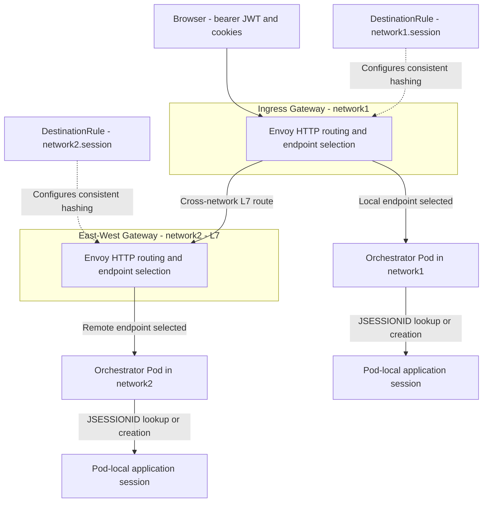
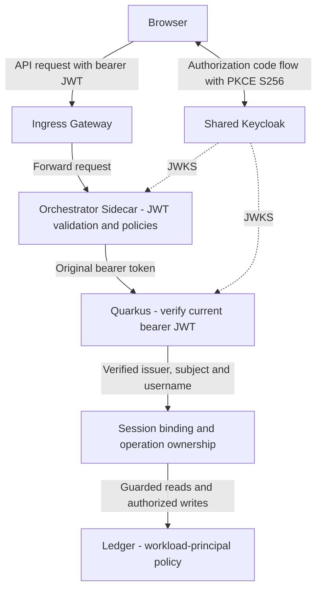

# Service mesh

This directory contains shared Istio routing, discovery, security and WasmPlugin
definitions. [ACM governance](../deploy/acm/README.md) and
[standalone profiles](../deploy/standalone/README.md) consume the same sources.
Gateway Deployments, Services and control planes are separate
[platform resources](../platform/openshift/ossm/README.md).

## Ingress and East-West routing

The [ingress VirtualService](traffic-management/virtual-services/ingress/virtual-service.yaml)
routes browser `/` requests to UI and `/api` requests directly to Orchestrator.
It rewrites the API request authority to
`intermesh-orchestrator.session.intermesh.com`, an intentional routing identity,
while preserving the URI path.

Each cluster has one East-West Gateway workload selected by two logical Gateways:

| Logical configuration | Traffic and TLS behavior |
| --- | --- |
| [L4 East-West Gateway](networking/gateways/east-west-l4/east-west-l4-gateway.yaml) | `AUTO_PASSTHROUGH` on 15443 for Ledger, Fraud Analytics and UI service hosts. It preserves the end-to-end workload mTLS connection. Orchestrator is excluded. |
| [Orchestrator L7 Gateway](networking/gateways/orchestrator-l7/orchestrator-l7-gateway.yaml) | HTTPS on 15443 with `ISTIO_MUTUAL`, using the dedicated authority and Orchestrator service-host pattern. Its [VirtualService](traffic-management/virtual-services/orchestrator/orchestrator-east-west-virtualservice.yaml) routes `/api` to Orchestrator on Service port 80. |

L7 termination permits HTTP routing and cookie-based endpoint selection for remote
Orchestrator requests. Ledger and Fraud retain the caller's workload identity
through L4 passthrough. These logical Gateways share a workload, not two separate
Deployments. Inspect effective listeners and filter chains on the deployed mesh;
source definitions alone do not establish their runtime acceptance.

## Discovery and identities

Each cluster has its own control plane and network identity. Shared-root mesh
trust, reciprocal remote-cluster discovery credentials and remote API/gateway
reachability are provisioning prerequisites outside these resource definitions.
Cross-network traffic uses gateway addresses rather than assuming direct Pod
connectivity. See the [topology](../docs/deployment-architecture.md#multicluster-topology).

The [Orchestrator ServiceEntry](networking/service-entries/internal/intermesh-orchestrator-se.yaml)
declares the internal service identity and the Orchestrator and East-West Gateway
SPIFFE subject alternative names. External ServiceEntries register
[PostgreSQL](networking/service-entries/external/serviceentry-db.yaml) on TCP/5432 and
[Keycloak](networking/service-entries/external/serviceentry-keycloak.yaml) on HTTPS/443.
The PostgreSQL ServiceEntry does not establish an egress allowlist.

## Session affinity

The following diagram illustrates the intended HTTP selection paths from network1.
Network2 has the corresponding local and remote paths. Gateway boxes contain the
Envoy HTTP routing and endpoint-selection functions. Dashed arrows show
DestinationRule configuration applied by Envoy, not an HTTP hop through a resource.
Effective proxy scope and cookie propagation must be checked on the deployed mesh.



| Cookie | Producer and purpose |
| --- | --- |
| `network1.session` | Envoy HTTP consistent hashing configured by the [network1 DestinationRule](traffic-management/destination-rules/network1/orchestrator-network1-dr.yaml). |
| `network2.session` | Envoy HTTP consistent hashing configured by the [network2 DestinationRule](traffic-management/destination-rules/network2/orchestrator-network2-dr.yaml). |
| `JSESSIONID` | The Orchestrator's [Vert.x SessionHandler](../src/intermesh-orchestrator/src/main/java/it/intermesh/bank/util/VertxSessionConfig.java) creates an identifier for Pod-local application state. It is not the DestinationRule hash key. |

Envoy can generate a missing affinity cookie; `ttl: 0s` configures a browser-session
cookie. Each cluster must receive only its matching DestinationRule because both
rules target the same service host. Browser requests carry cookies, and responses
can set them across the selected gateway path. No cookie needs to be readable by
frontend JavaScript.

Application sessions are bound to the current verified `(iss, sub)`. A different
subject cannot reuse the state: its request is rejected and the session invalidated.
When a Pod has no usable local session, a valid JWT can initialize a clean one.
Affinity does not replicate session state or guarantee its survival after Pod or
endpoint changes. Preserve all three cookie names and test local/remote selection,
failover and cookie attributes separately.

This is a Sidecar implementation. No Ambient profile, waypoint configuration or
equivalent Ambient affinity behavior is supplied.

## Authentication and authorization



The [frontend](../src/intermesh-ui/src/js/app.js) uses realm `intermesh-bank`, public
client `intermesh-frontend` and PKCE S256. It sends the bearer token on API requests.
The committed [RequestAuthentication](security/request-authentications/jwt-request-authentication.yaml)
selects Orchestrator, validates the configured issuer/JWKS and forwards the original
token. It does not select the ingress workload.

The [DENY policy](security/authorization-policies/static/deny-orchestrator-without-jwt.yaml)
rejects requests without a validated request principal on Orchestrator workload
port `8080`, regardless of URI. Applicable DENY policies take precedence: a matching
DENY rejects the request even when an ALLOW matches. Applicable ALLOW policies use
OR semantics; any matching ALLOW can permit a request that is not denied. The
[issuer-principal policy](security/authorization-policies/oidc/jwt-authorization-policy.yaml)
and [gateway-namespace policy](security/authorization-policies/static/allow-hub-to-orchestrator.yaml)
are alternatives, not requirements that must both match. Independent Quarkus JWT
verification and application ownership checks remain separate controls.

Quarkus independently verifies the current bearer token using
[BankingIdentityProvider](../src/intermesh-orchestrator/src/main/java/it/intermesh/bank/security/BankingIdentityProvider.java).
The immutable subject identity is `(iss, sub)`; a verified, nonblank
`preferred_username` is the Ledger owner key.
[BankingSessionGuard](../src/intermesh-orchestrator/src/main/java/it/intermesh/bank/security/BankingSessionGuard.java)
checks session binding before banking operations. Application checks enforce
same-user lookup, history ownership and transfer-source ownership; account creation
uses the verified owner key. Destination-account ownership is not required.

[Ledger](security/authorization-policies/static/allow-orchestrator-to-ledger.yaml)
and [Fraud Analytics](security/authorization-policies/static/allow-orchestrator-to-analytics.yaml)
ALLOW only `cluster.local/ns/intermesh-backend/sa/intermesh-orchestrator-sa`.
L4 passthrough is important to preserve this source principal across networks.
The [Ledger client](../src/intermesh-orchestrator/src/main/java/it/intermesh/bank/restclient/LedgerClient.java)
sends verified issuer, subject and owner metadata on admission and recovery calls;
it does not automatically forward the browser JWT. These headers rely on the
mesh-authenticated Orchestrator boundary and are not independently signed tokens.

The sources do not configure an explicit API audience or namespace-wide STRICT
PeerAuthentication. Verify effective mTLS, policy composition and unauthorized
caller rejection on the deployed mesh. Keep the UI URL, Quarkus issuer, Istio
issuer/JWKS/principal and Keycloak discovery host aligned through the
[shared configuration](../docs/examples/README.md#shared-keycloak-endpoint).

## Wasm and Fraud scenarios

The [WasmPlugin](wasm/security-headers-wasmplugin.yaml) selects Orchestrator proxies,
loads an OCI artifact with `imagePullPolicy: Always` and uses `FAIL_OPEN`.
The [Rust implementation](../src/security-headers-wasmplugin/src/lib.rs) matches a
Fraud `:authority` and adds `x-intermesh-channel: Web-Channel-Hub` and
`x-intermesh-route-class: Authenticated`. These are routing markers, not JWT claims
or evidence that the inactive Channel Hub workload is deployed.

The [Fraud VirtualService](traffic-management/virtual-services/fraud-analytics/fraud-analytics-chaos-virtualservice.yaml)
injects HTTP 503 when the expected route-class marker is absent or different.
The standard route has a three-second timeout. The
[Fraud service](../src/fraud-analytics/app.py) deliberately sleeps four seconds
for a `DE`-prefixed destination and 0.1 seconds otherwise. This exercises the
Orchestrator's transaction-specific compensation and uncertain-outcome reporting.
`FAIL_OPEN` allows processing to continue if the plugin fails; it does not bypass
the VirtualService's marker check or guarantee successful Fraud requests.

Under ACM, the Fraud VirtualService is reconciled by its Policy. Under standalone,
it is applied directly from the same source. Workload-unavailability demonstrations
also need to account for ACM replica reconciliation; use the
[operational procedure](../docs/acm-deployment-readiness.md#workload-unavailability-and-restoration).

## Resource groups and rendering

From the repository root, without executable plugins:

```sh
oc kustomize service-mesh/networking/gateways
oc kustomize service-mesh/networking/service-entries
oc kustomize service-mesh/traffic-management/virtual-services
oc kustomize service-mesh/traffic-management/destination-rules/network1
oc kustomize service-mesh/traffic-management/destination-rules/network2
oc kustomize service-mesh/security/authorization-policies
oc kustomize service-mesh/security/request-authentications
oc kustomize service-mesh/wasm
```

A complete per-network profile includes three Gateways, three ServiceEntries,
three VirtualServices, one DestinationRule, six AuthorizationPolicies, one
RequestAuthentication and one WasmPlugin: 18 Istio resources. Explicit source
lists and contained ACM input wrappers preserve resource membership and normal
Kustomize load restrictions. Do not apply these groups separately alongside ACM
ownership. Channel Hub has no active Deployment, Service or AuthorizationPolicy.
